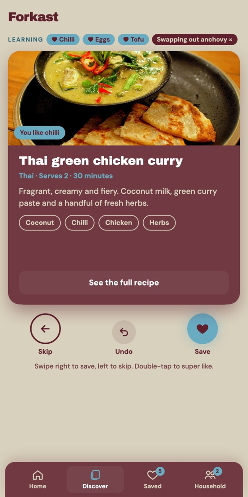
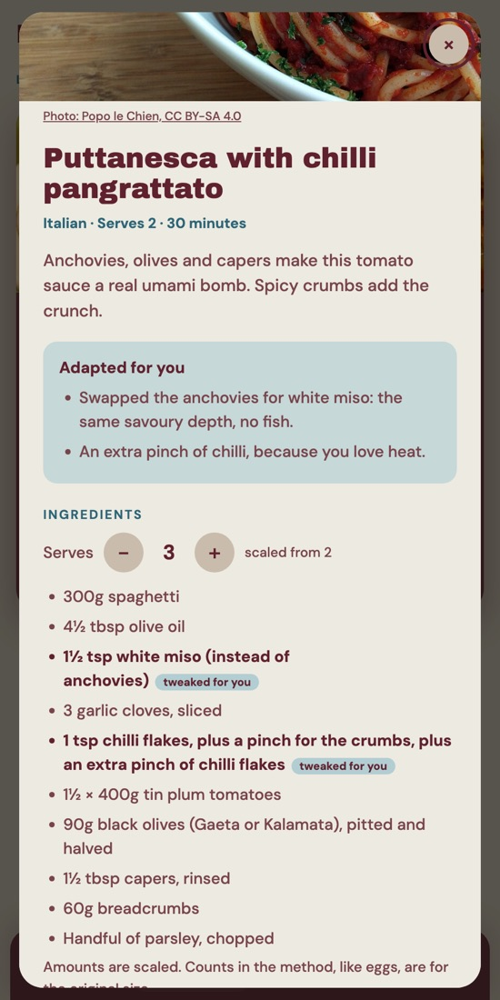
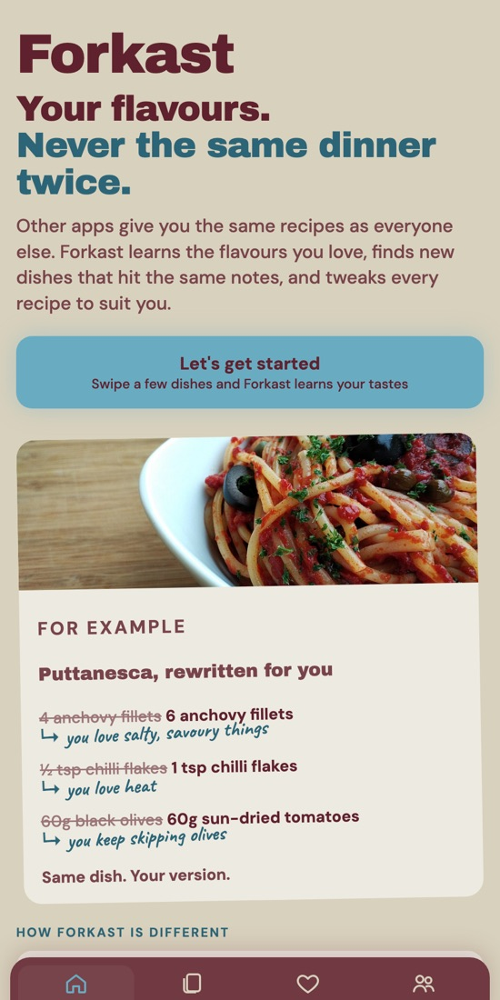
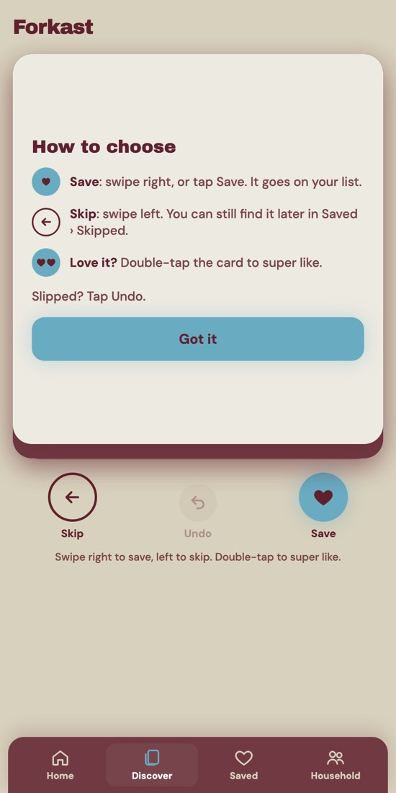
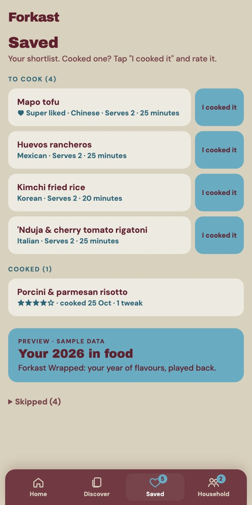
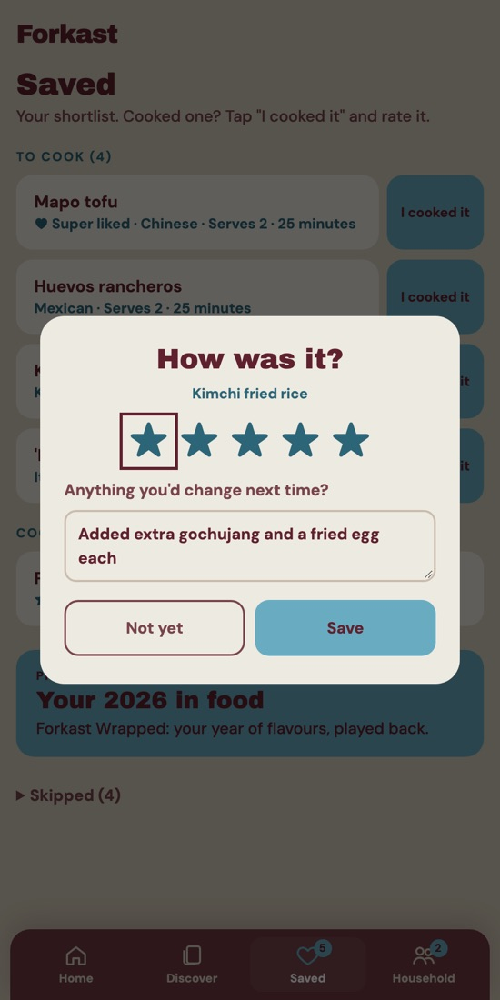
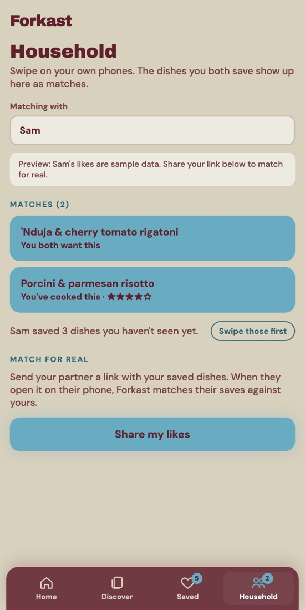
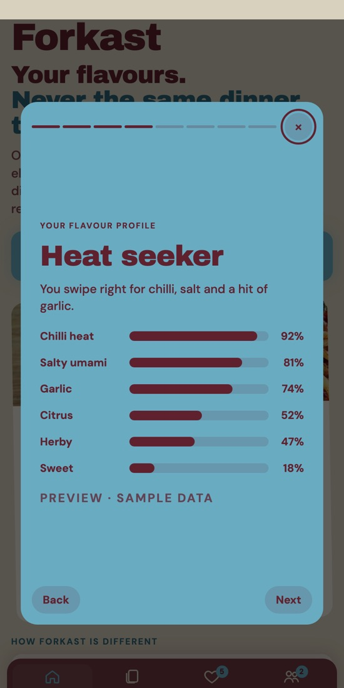

# Forkast: product requirements document

**Your flavours. Never the same dinner twice.**

Forkast is a swipe-to-decide recipe app that learns the flavours you love, shows you new dishes that hit the same notes, and rewrites each recipe to suit you. This PRD was written after the hackday build and two rounds of user testing.

| | |
| --- | --- |
| Live app | https://alexhuyton.github.io/forkast/ |
| Returning-user prototype | https://alexhuyton.github.io/forkast/prototypes/home-returning.html |
| Design brief | [docs/brief.md](docs/brief.md) |
| Status | Live hackday build · 2 rounds of user testing · 35 dishes, 19 cuisines · 12 of 16 requirements built |

## The problem

Home cooks are stuck in a rut. Recipe apps offer everyone the same recipes, most of them not tuned to that person's taste, so people fall back on the few dishes they know. Nearly half of UK adults rotate about **5 meals** ([Morrisons survey, via Food Manufacture](https://www.foodmanufacture.co.uk/Article/2013/09/24/Food-recipe-trap-snares-half-of-Britons/)).

**Goal:** help people discover and actually cook new dishes that suit their tastes, so their repertoire grows.

| How we'll know | Target |
| --- | --- |
| Save rate in a tester's last 10 cards vs their first 10 | +15 points |
| Testers rate what it learned as accurate | 4 out of 5 |
| Testers save a dish they've never cooked | 80% |
| Testers cook a saved dish within a week | 50% |

## Two USPs

1. **Variety within your flavour profile.** Every save and skip teaches Forkast what you love. The deck starts varied, then leans towards your flavours across every cuisine: new dishes, not more of the same.
2. **Recipes rewritten for you.** Each recipe adapts to your tastes and your own cooking notes. *"You love salty, savoury flavours, so we've added two extra anchovies."*

  
  

## Users and key moments

| Persona | Who |
| --- | --- |
| **Rut-breaker** (primary) | Confident home cook with clear flavour likes, bored of the same few dishes |
| Tonight decider | Tired after work. Needs one good answer, fast |
| Household pair | Two people agreeing what to cook, without the back and forth |

Key moments: **Inspiration** (Discover deck) → **Deciding tonight** (Saved list) → **Agreeing** (Household) → **Cooking** (recipe and servings) → **After cooking** (rating, your version, Wrapped).

These are proto-personas from the design brief, sharpened by two rounds of user testing.

## The journey, in the real app

Screenshots of the live build, following one tester who loves chilli and keeps skipping anchovies.

| | | | |
| --- | --- | --- | --- |
|  |  |  |  |
| **1. Let's get started** (F1) | **2. How to choose** (F2, F4, F5) | **3. It learns as you swipe** (F3, F6, F7) | **4. Your recipe, rewritten** (F8, F9, F10) |
|  |  |  |  |
| **5. Saved, cooked, skipped** (F11, F12) | **6. How was it?** (F11) | **7. Cook together** (F13) | **8. Your year in food** (F14) |

## Scope

**In scope:** a first-time home page that sells both USPs; swiping a varied deck of 35 dishes across 19 cuisines, with taste learning; recipes adapted to learned tastes, with servings scaling; saved, cooked, rated and skipped lists, with your own notes; household matching through a share link; Forkast Wrapped as a sample-data preview.

**Out of scope, for now:** accounts and sync; AI rewriting of recipes from free-text notes; an onboarding questionnaire (tried and removed); a home page for returning users (separate prototype); shopping lists, nutrition, pantry or meal planning; recipe sourcing at scale.

## Functional requirements

12 built, 4 partly built. The partly built ones need an AI model (adapted recipes, cooking notes), a server (two-way household sync) or a year of real data (Wrapped) to finish.

| ID | Requirement | Acceptance criteria | Status |
| --- | --- | --- | --- |
| F1 | First-time home | Sells both USPs. The button always reads "Let's get started". The example recipe isn't tappable. "Start over as a new user" clears all data. | Built |
| F2 | First-time tip | Explains Save, Skip, Undo and double-tap on the first visit. Gone after "Got it" or the first choice. | Built |
| F3 | A varied deck | The next card is the least like the last few seen, by tags and cuisine. A new user's first 10 cards span 8 or more cuisines. | Built |
| F4 | Save and Skip | Swipe right, tap Save or press the right arrow to save; left to skip. Drags under 120px spring back. Every choice offers Undo. | Built |
| F5 | Double-tap super like | A heart pops, the dish is saved, counts double for learning and goes to the top of To cook. | Built |
| F6 | Taste learning | Saved 2 or more times is a like; skipped 3 or more times and never saved is a dislike. A Learning strip shows both, with one-tap undo. | Built |
| F7 | Ranking | Dishes with liked tags come forward. Dislikes with no swap go to the back. Undo and partner picks jump the queue. | Built |
| F8 | Recipes adapted to you | Swaps for learned dislikes (miso for anchovies and more) and nudges for liked flavours, with changed lines marked. Fixed rules, not AI yet. | Partly built |
| F9 | A photo of every dish | All 35 dishes show a photo checked against the dish. Wikimedia Commons credits appear in the recipe view. | Built |
| F10 | Servings scale | A stepper scales amounts sensibly, such as whole garlic cloves and half tins. The number you choose becomes your default. | Built |
| F11 | Cook, rate, make it yours | "I cooked it" records a rating and a note. Notes show as "Your version" next time. The steps themselves aren't rewritten yet. | Partly built |
| F12 | Skipped dishes archived | Saved › Skipped lists them to save or put back, and the empty deck offers them again. Not built yet: a temporary archive that expires. | Built |
| F13 | Household matching | Dishes you both saved show as matches. A share link loads your saves on their phone. One-way, with no sync. | Partly built |
| F14 | Forkast Wrapped | An eight-slide year-end recap with food and recipe insights such as your flavour profile ("Heat seeker"), labelled as sample data. | Partly built |
| F15 | Navigation | Home, Discover, Saved and Household. Each page has its own link, and the back button works. | Built |
| F16 | Progress kept on the device | Saves, ratings, notes and learning stay in the browser, and older saved data migrates to the current model. | Built |

## Non-functional requirements

| Area | Requirement |
| --- | --- |
| Mobile first | Works on phones from 360×640 up. No sideways scrolling; the choice buttons stay above the nav. |
| Accessible | Every gesture has a labelled button and arrow keys. Photos have alt text. Undo after every choice. |
| Visual style | Beige page, maroon text, maroon kept for swipe cards and nav. Colours are role tokens, changeable in one place. |
| Private by default | No accounts and nothing sent to a server. Data lives in the browser; "Start over" wipes it. |
| Image licensing | Wikimedia Commons photos are credited in the recipe view, as their licences require; the rest are Unsplash. |
| Simple hosting | One static page on GitHub Pages. Each screen has its own link, so the back button works. |

## Decisions log

What two rounds of user testing changed, newest first.

| # | Decision | Why |
| --- | --- | --- |
| 1 | Home always says "Let's get started"; first point is "It learns from you" | The home page is for first-time users |
| 2 | Save and Skip only, with a browsable Skipped list | "Never" vs "Not now" confused testers |
| 3 | Deck widened to 35 dishes across 19 cuisines | The founder's own flavours were limiting everyone else |
| 4 | Questionnaire removed; varied first cards do the learning | Fixed options felt prescriptive, and swiping is the fun part |
| 5 | Home shows a rewritten-for-you example, not a photo grid | The grid looked tappable but wasn't |
| 6 | Recipes adapted to you, with servings and your own notes | Testers wanted recipes to be theirs: a second USP |
| 7 | Double-tap super like replaces swipe up | Swipe up confused people; the control was the problem |
| 8 | Labelled buttons, a first-time tip and Undo | Swiping wasn't obvious or accessible, and was too easy to trigger |
| 9 | A fresh start for new users | A tester saw the founder's history and was confused by the anchovy label |
| 10 | Photos on every card | Helps people who can't picture a dish from its name (aphantasia) |
| 11 | Learning from skips infers dislikes | Testers said a "no" taught the app nothing |
| 12 | Together renamed Household | Testers didn't spot it in the menu |

## Risks, assumptions and dependencies

| Type | Item | Mitigation |
| --- | --- | --- |
| Risk | 35 dishes may be too few for swipes to predict taste | Measure save-rate lift; widen the deck |
| Risk | Rule-based adaptations can feel generic or clumsy | Move to an AI model that rewrites the whole recipe |
| Risk | Three skips may not mean a real dislike | Every inference is shown and can be undone in one tap |
| Risk | Household matching is one-way | Accounts and sync in a real product |
| Assumption | Personas rest on the founder's experience and a small sample of tests | Run the interview guide and swipe test from the brief |
| Dependency | Real recipe rewriting needs an AI model behind a small server | Keep the hackday static; plan a backend next |
| Dependency | Photos load from Wikimedia Commons and Unsplash | Copy them into the repo before any wider launch |

## What's next

| ID | Requirement |
| --- | --- |
| **L1** | **AI-rewritten recipes:** apply learned tastes and your own notes to the full recipe, not just fixed swaps |
| L2 | Returning-user home: tonight's pick, your list, rate-it nudges and your flavours this month ([prototype](https://alexhuyton.github.io/forkast/prototypes/home-returning.html)) |
| L3 | Accounts and sync, so saves follow you and household matching works both ways |
| L4 | Keep adding new recipes to the deck, from a larger licensed or user-imported source |
| L5 | Wrapped built from a real year of swipes, saves and ratings |
| L6 | Tonight filters: time, effort and what's in the fridge |

## Open questions

- How many swipes before the deck feels like it gets you? Is 10 realistic?
- Should a skip ever mean never again, say for allergies?
- How much can Forkast change a recipe before it stops being the original dish?
- Which AI approach fits recipe rewriting, and what does it cost per recipe?
- What makes Wrapped worth coming back for monthly, not just yearly?
- Is household matching core for couples, or a fun extra?

---

Screenshots in `docs/screens/` are from the live build with a sample tester. Dish photos inside the app come from Wikimedia Commons and Unsplash and are credited there.
